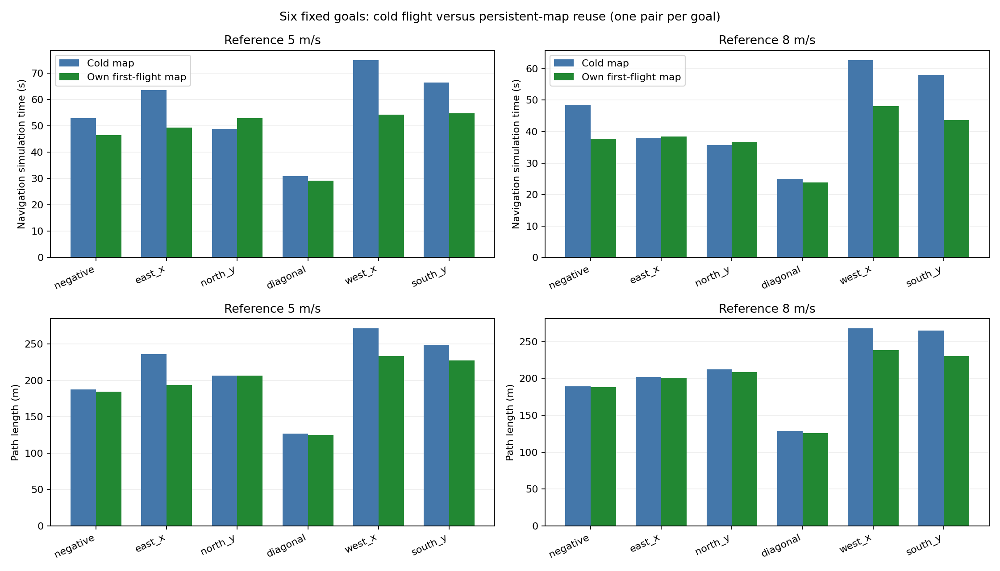

# 最终六点首飞／复飞对比

数据来自完整批次、源码/配置/地图哈希审计和 replay 加载器录像验收。高度 h 为正高度，代码 z=-h。每格顺序为首飞 / 复飞。

计划汇总 5 与 8 m/s 两档共 24 次飞行，两档是否齐全：True。

最终门禁：通过；跨速度档源码一致：True；与当前源码匹配：True；同目标除速度和输出路径外配置一致：True。

## 5 m/s：paired_final_5

12 次门禁：True。最小原始 / 膨胀障碍净空 3.49 / 2.70 m；最长远端低速 1.08 s；最大当前终点误差 0.996 m。
实际速度 p90 范围 4.85–4.90 m/s，瞬时最大 5.55 m/s。

| 目标 (x,y,h) | 仿真导航 s | 路径 m | 当前终点误差 m | 距原目标 m |
|---|---:|---:|---:|---:|
| (-120,-120,20) | 52.81 / 46.38 | 187.68 / 184.68 | 0.95 / 0.93 | 15.76 / 14.71 |
| (200,20,20) | 63.45 / 49.31 | 236.26 / 193.95 | 0.70 / 0.83 | 33.12 / 33.44 |
| (20,200,20) | 48.86 / 52.80 | 206.76 / 206.58 | 0.99 / 0.99 | 0.99 / 0.99 |
| (100,70,20) | 30.78 / 29.13 | 127.23 / 124.82 | 0.46 / 0.86 | 0.46 / 0.86 |
| (-200,20,20) | 74.91 / 54.18 | 271.48 / 233.74 | 0.99 / 0.66 | 0.99 / 0.66 |
| (-20,-200,20) | 66.44 / 54.71 | 249.20 / 227.63 | 1.00 / 0.44 | 1.00 / 0.44 |

两个建筑内部目标的终点为安全接近点，其余四个为原坐标到达。每点只有一组配对，路线及仿真调度存在变化；不能将这些改善幅度当作重复统计结果，也不能将内部目标不同终点的省时全部归于地图。

## 8 m/s：paired_final_8

12 次门禁：True。最小原始 / 膨胀障碍净空 3.52 / 2.64 m；最长远端低速 1.04 s；最大当前终点误差 0.989 m。
实际速度 p90 范围 7.48–7.75 m/s，瞬时最大 8.16 m/s。

| 目标 (x,y,h) | 仿真导航 s | 路径 m | 当前终点误差 m | 距原目标 m |
|---|---:|---:|---:|---:|
| (-120,-120,20) | 48.42 / 37.73 | 189.01 / 188.30 | 0.91 / 0.93 | 16.42 / 14.50 |
| (200,20,20) | 37.83 / 38.44 | 201.72 / 200.80 | 0.71 / 0.97 | 30.68 / 29.70 |
| (20,200,20) | 35.80 / 36.78 | 212.01 / 208.42 | 0.85 / 0.98 | 0.85 / 0.98 |
| (100,70,20) | 24.99 / 23.87 | 128.76 / 125.76 | 0.57 / 0.33 | 0.57 / 0.33 |
| (-200,20,20) | 62.69 / 48.06 | 267.70 / 238.22 | 0.99 / 0.97 | 0.99 / 0.97 |
| (-20,-200,20) | 57.93 / 43.64 | 264.86 / 230.28 | 0.98 / 0.67 | 0.98 / 0.67 |

两个建筑内部目标的终点为安全接近点，其余四个为原坐标到达。每点只有一组配对，路线及仿真调度存在变化；不能将这些改善幅度当作重复统计结果，也不能将内部目标不同终点的省时全部归于地图。

## 速度档之间的对比

| 精确到达目标 | 5 / 8 m/s 首飞仿真导航 s | 5 / 8 m/s 复飞仿真导航 s |
|---|---:|---:|
| (20,200,20) | 48.86 / 35.80 | 52.80 / 36.78 |
| (100,70,20) | 30.78 / 24.99 | 29.13 / 23.87 |
| (-200,20,20) | 74.91 / 62.69 | 54.18 / 48.06 |
| (-20,-200,20) | 66.44 / 57.93 | 54.71 / 43.64 |

